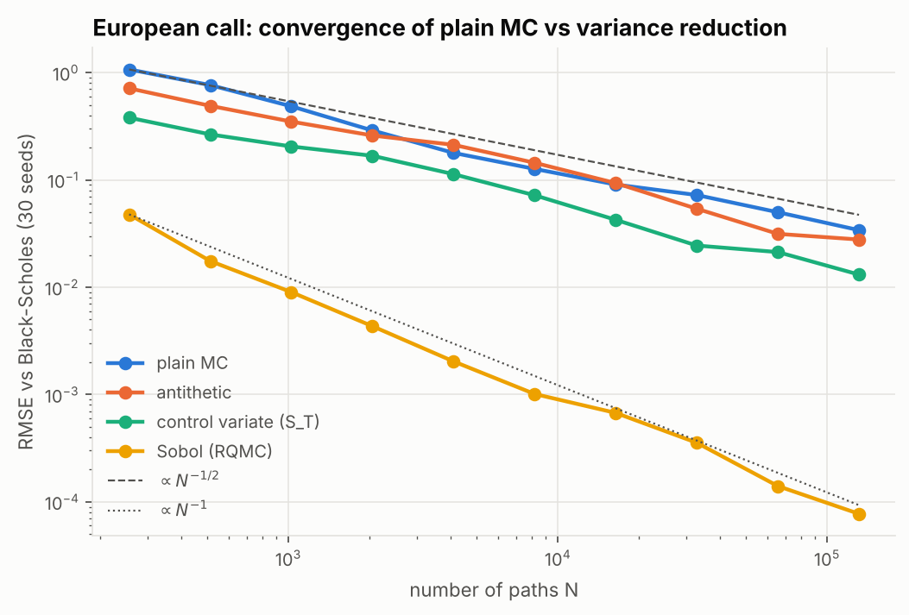
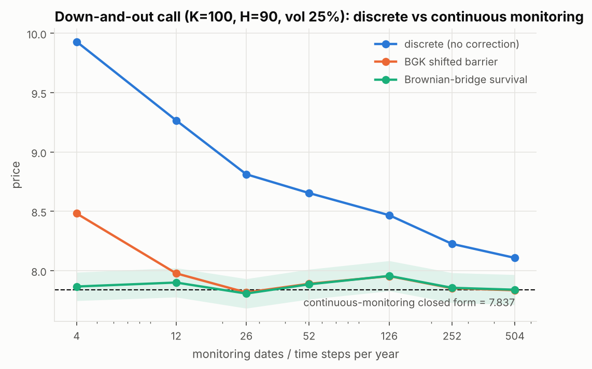
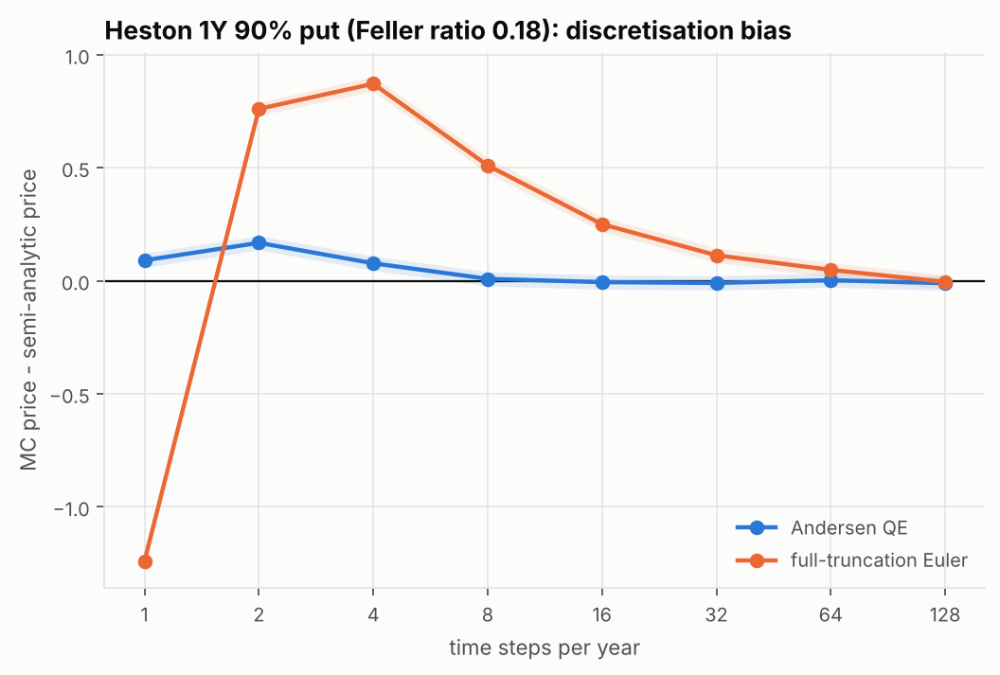
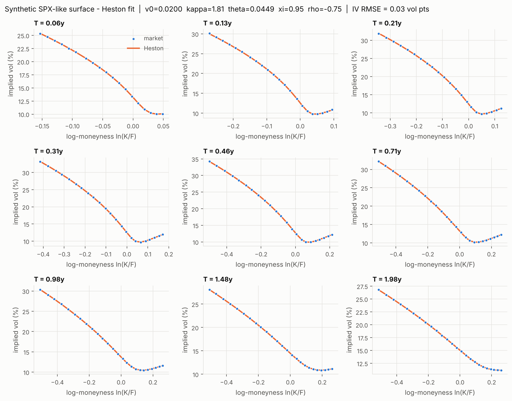

# Monte Carlo Pricing of Vanilla and Exotic Options

[](https://github.com/LucaDennert/mc-option-pricing/actions/workflows/tests.yml)


A from-scratch, fully vectorised Monte Carlo library for equity derivatives, written in NumPy/SciPy:
three models, six product families, four variance-reduction techniques, MC Greeks, and a
Heston calibration pipeline fed by **OptionMetrics IvyDB** (via WRDS). Every Monte Carlo
estimator is validated against a closed-form or semi-analytic benchmark in the test-suite.

📄 **Results summary (4 pages, PDF): [`report/results_summary.pdf`](report/results_summary.pdf)**

The end-to-end question the project answers: *if two models agree on the at-the-money
vanilla price, how much do they disagree on exotics?* - i.e. model risk from the volatility
smile.

---

## Highlights

| | |
|---|---|
| **Models** | Black-Scholes (exact log-normal stepping) · Heston with Andersen's **QE scheme** (and full-truncation Euler for comparison) · Merton jump-diffusion (exact) |
| **Products** | European · digital · Asian (arithmetic / geometric) · **8 single-barrier types** · lookbacks (fixed / floating) · **Phoenix autocallable** with memory coupon and knock-in |
| **Variance reduction** | antithetic variates · control variates with optimal β (multi-CV) · **randomized QMC** (scrambled Sobol) · **Brownian-bridge** path construction |
| **Barrier monitoring** | discrete · Broadie-Glasserman-Kou shift · exact Brownian-bridge crossing probabilities |
| **Greeks** | bump-and-revalue with common random numbers · pathwise · likelihood ratio |
| **Benchmarks** | Black-Scholes, Reiner-Rubinstein barriers, Kemna-Vorst geometric Asian (arbitrary fixings), Goldman-Sosin-Gatto lookback, Merton series, Heston (Albrecher "little trap" CF) |
| **Market data** | OptionMetrics loader: quote filters, put-call-parity implied forwards / dividend yields, zero curve, OTM surface, own implied vols |
| **Calibration** | vega-weighted Heston least-squares on the full surface |
| **Engineering** | `src/` package, 47 pytest tests (≈3 s), GitHub Actions CI on Python 3.10-3.13, reproducible scripts |

---

## Results

All figures and tables below are produced by `python scripts/run_benchmarks.py` and
`make exotics` (numbers can differ in the last digit across machines).

### 1. Convergence: plain MC vs variance reduction



RMSE against the Black-Scholes price over 30 independent seeds. Pseudo-random estimators
converge at the canonical $O(N^{-1/2})$ rate (variance reduction only shifts the line down);
scrambled Sobol points reach close to $O(N^{-1})$ - **~400x lower error at 131k paths**.

### 2. Arithmetic Asian: stacking variance-reduction techniques

| method | price | std error | variance reduction |
|:--|--:|--:|--:|
| plain MC | 5.3135 | 3.13e-02 | 1x |
| antithetic | 5.3327 | 2.35e-02 | 2x |
| geometric-Asian control variate | 5.3256 | 8.41e-04 | 1,389x |
| Sobol + Brownian bridge (RQMC) | 5.3245 | 7.54e-04 | 1,726x |
| **Sobol + Brownian bridge + CV** | **5.3247** | **2.04e-04** | **23,585x** |

The geometric Asian has an exact price for any set of fixing dates and is almost perfectly
correlated with the arithmetic one, making it a near-ideal control variate. Full table
(including CPU-time-adjusted efficiency): [`results/asian_variance_reduction.md`](results/asian_variance_reduction.md).

### 3. Barrier options: discrete vs continuous monitoring



Checking the barrier only on the grid misses crossings between dates and overprices the
knock-out by **~18% with monthly (12) monitoring dates**. Two fixes:
the Broadie-Glasserman-Kou shift $H \to H e^{\pm 0.5826\,\sigma\sqrt{\Delta t}}$, and the exact
Brownian-bridge survival probability between grid points,
$\;p_i = 1-\exp\!\big(-2\ln(S_i/H)\ln(S_{i+1}/H)/(\sigma^2\Delta t)\big)$,
which is unbiased even with 4 time steps.

### 4. Heston discretisation: QE vs Euler



With realistic index parameters the Feller condition fails ($2\kappa\theta/\xi^2 = 0.18$) and the
variance process spends a lot of time near zero. Full-truncation Euler needs ~100 steps/year
to remove its bias; Andersen's QE scheme is unbiased from ~8 steps/year.

### 5. Model risk on exotics: Black-Scholes vs calibrated Heston

Heston calibrated to the surface (fit below); Black-Scholes uses the Heston-implied ATM vol
of the same maturity, so **both models agree on the ATM call**. Prices in % of spot,
daily monitoring.

| product | BS (flat ATM vol) | Heston | difference |
|:--|--:|--:|--:|
| ATM call 1Y | 7.47 | 7.45 | -0.02 *(within MC error)* |
| Digital call 105% 1Y (pays 100) | 40.56 | 54.84 | **+14.27** |
| Down-and-out call K100 H80 1Y | 7.46 | 7.22 | -0.24 |
| Down-and-in put K100 H75 1Y | 0.94 | 3.34 | **+2.40** |
| Up-and-out call K100 H120 1Y | 2.18 | 5.59 | **+3.41** |
| Asian call 1Y | 4.43 | 4.24 | -0.19 |
| Floating lookback call 1Y | 12.22 | 13.72 | +1.50 |
| Phoenix autocall 3Y (2% quarterly cpn, KI 60%) | 101.69 | 100.27 | **-1.43** |

Reading the table like a desk would:

* **Digital**: under skew a digital is minus the strike-derivative of the call price, so
  $D = D_{BS} - \text{Vega}\cdot\partial\sigma/\partial K$; negative skew makes the digital call much more expensive.
* **Down-and-in put / autocallable**: the knock-in put sits where implied vol is highest; a
  flat-vol model undervalues it ~3.5x. The investor in a Phoenix is short that put, so the
  certificate is worth less under Heston - **flat-vol pricing would overstate fair value by ~1.4 points**.
* **Up-and-out call**: Heston's upside vol is low (~10%), so the knock-out is less likely.



> The figures in this README use a **synthetic SPX-like surface** generated by
> `scripts/make_synthetic_surface.py` (so the repo runs anywhere, including CI). Run the
> OptionMetrics pipeline below to reproduce them on real SPX quotes.

### 6. Greeks

| Greek | closed form | bump & revalue (CRN) | single-run estimator |
|:--|--:|--:|:--|
| call delta | 0.5735 | 0.5735 | pathwise 0.5747 ± 0.0026 |
| call gamma | 0.0194 | 0.0193 | - |
| call vega | 38.715 | 38.780 | - |
| digital delta | 0.0194 | 0.0196 | likelihood ratio 0.0193 ± 0.0001 |

The pathwise estimator is zero almost surely for a digital (discontinuous payoff); the
likelihood-ratio method differentiates the density instead and stays unbiased.

---

## Real data: OptionMetrics (WRDS)

```bash
pip install -e ".[dev,wrds]"
python scripts/fetch_optionmetrics.py --date 2023-12-29 --wrds-user <username>
python scripts/calibrate_heston.py --input data/raw/SPX_2023-12-29.csv
python scripts/price_exotics.py   --input data/raw/SPX_2023-12-29.csv \
                                  --params results/heston_params_SPX_2023-12-29.json
```

What `mcpricer.data.optionmetrics` does:

1. **Download** one day from IvyDB US: option quotes (`optionm.opprcdYYYY`), underlying close
   (`optionm.secprdYYYY`), zero curve (`optionm.zerocd`). SPX is `secid = 108105`.
2. **Filter**: standard settlement (`ss_flag = 0`), AM-settled monthlies (optional), positive bid,
   ask > bid, relative spread ≤ 50%, mid ≥ 0.10, 7-730 days, 0.7 ≤ K/F ≤ 1.3.
3. **Forwards**: per expiry, $F = K + (C-P)/D(T)$ from put-call parity on the strikes nearest the
   money, with $D(T)$ from the interpolated zero curve. This gives an implied dividend yield
   $q(T) = r(T) - \ln(F/S)/T$ that is consistent with the quotes - more robust than a
   projected dividend yield.
4. **Surface**: keep OTM options only (puts below F, calls above), recompute implied vols with
   our own $r(T), q(T)$ so that calibration and pricing use one consistent set of inputs.

> **Data licence.** OptionMetrics data are licensed through WRDS and may not be redistributed.
> `data/raw/` is git-ignored; only code, synthetic data and aggregate results/figures belong in the
> repository.

---

## Quick start

```bash
git clone https://github.com/LucaDennert/mc-option-pricing.git
cd mc-option-pricing
pip install -e ".[dev]"
pytest -q                      # 47 tests, ~3 s
make all                       # tests + benchmark figures + calibration + exotics table
```

```python
from mcpricer import BlackScholes, Heston, MonteCarloEngine, Barrier, Asian, ControlVariate
from mcpricer.analytic import geometric_asian_price

bs = BlackScholes(S0=100, r=0.03, q=0.01, sigma=0.2)
eng = MonteCarloEngine(n_paths=2**16, n_steps=252, method="sobol")

# continuously-monitored down-and-out call, Brownian-bridge correction
eng.price(bs, Barrier(100, 90, 1.0, "call", "down-and-out", monitoring="continuous", sigma=0.2))

# arithmetic Asian with the geometric Asian as control variate
geo = Asian(100, 1.0, 12, average="geometric")
cv = ControlVariate(geo, geometric_asian_price(100, 100, 1.0, 0.03, 0.01, 0.2, geo.fixing_times))
eng.price(bs, Asian(100, 1.0, 12), control_variates=cv)
# -> price ≈ 5.325, standard error ~1e-4

heston = Heston(100, 0.03, 0.01, v0=0.02, kappa=1.8, theta=0.045, xi=0.95, rho=-0.75)
MonteCarloEngine(n_paths=2**17, n_steps=52).price(heston, Barrier(100, 120, 1.0, "call", "up-and-out"))
```

---

## Methodology notes

**Design.** A `Model` maps a time grid and a `RandomSource` to paths; a `Payoff` maps paths to
*discounted* cash-flows (so products with intermediate payments, such as autocallables, fit the
same interface); the `MonteCarloEngine` merges every payoff date into the grid, simulates in
memory-bounded batches and applies variance reduction. All randomness flows through one primitive
(uniforms → inverse CDF), so antithetic sampling, Sobol points and the QE scheme's uniform draws
are interchangeable.

**Honest standard errors.** With antithetic sampling the i.i.d. unit is the pair average, not
each path. With RQMC, the error bar comes from 16 independent scramblings of the Sobol sequence.

**Heston QE (Andersen 2008).** The variance step matches the first two conditional moments of the
non-central χ² either with a squared Gaussian ($\psi \le 1.5$) or a mass at zero plus an
exponential tail ($\psi > 1.5$). Log-spot uses the central discretisation of
$\int v\,dt$ and the exact correlation term $\frac{\rho}{\xi}(v_{t+\Delta}-v_t-\kappa\theta\Delta+\kappa\int v)$.

**Heston pricing for calibration.** Gil-Pelaez inversion of the "little trap" characteristic
function (Albrecher et al. 2007, no branch-cut discontinuities), 256-node Gauss-Legendre
quadrature vectorised across strikes; objective $(P^{model}-P^{mkt})/\text{Vega}_{BS}$ ≈ implied-vol error.

---

## Project structure

```
mc-option-pricing/
├── src/mcpricer/
│   ├── random.py          # pseudo / scrambled Sobol, antithetic, Brownian bridge
│   ├── models.py          # BlackScholes, Heston (QE / Euler), MertonJD
│   ├── payoffs.py         # European, Digital, Asian, Barrier, Lookback, Autocallable
│   ├── engine.py          # MonteCarloEngine, control variates, RQMC error bars
│   ├── analytic.py        # closed forms + Heston characteristic function
│   ├── greeks.py          # CRN bump Greeks, pathwise, likelihood ratio
│   ├── calibration.py     # Heston calibration
│   └── data/optionmetrics.py
├── scripts/               # benchmarks, data download, calibration, exotics table
├── tests/                 # MC vs closed forms, calibration, data cleaning
├── data/sample/           # synthetic surface (safe to publish)
├── data/raw/              # OptionMetrics downloads (git-ignored)
├── results/               # figures and tables used in this README
```

---

## References

* Glasserman, P. (2003). *Monte Carlo Methods in Financial Engineering*. Springer.
* Andersen, L. (2008). Simple and efficient simulation of the Heston stochastic volatility model. *Journal of Computational Finance* 11(3).
* Heston, S. (1993). A closed-form solution for options with stochastic volatility. *Review of Financial Studies* 6(2).
* Albrecher, H., Mayer, P., Schoutens, W., Tistaert, J. (2007). The little Heston trap. *Wilmott Magazine*.
* Broadie, M., Glasserman, P., Kou, S. (1997). A continuity correction for discrete barrier options. *Mathematical Finance* 7(4).
* Kemna, A., Vorst, A. (1990). A pricing method for options based on average asset values. *Journal of Banking & Finance* 14(1).
* Reiner, E., Rubinstein, M. (1991). Breaking down the barriers. *Risk* 4(8).
* Goldman, M., Sosin, H., Gatto, M. (1979). Path dependent options: "buy at the low, sell at the high". *Journal of Finance* 34(5).
* Merton, R. (1976). Option pricing when underlying stock returns are discontinuous. *Journal of Financial Economics* 3.
* Haug, E. G. (2007). *The Complete Guide to Option Pricing Formulas*, 2nd ed. McGraw-Hill.

---

*Author: Luca Dennert - MSc Finance, Università Bocconi. Licensed under MIT.*
